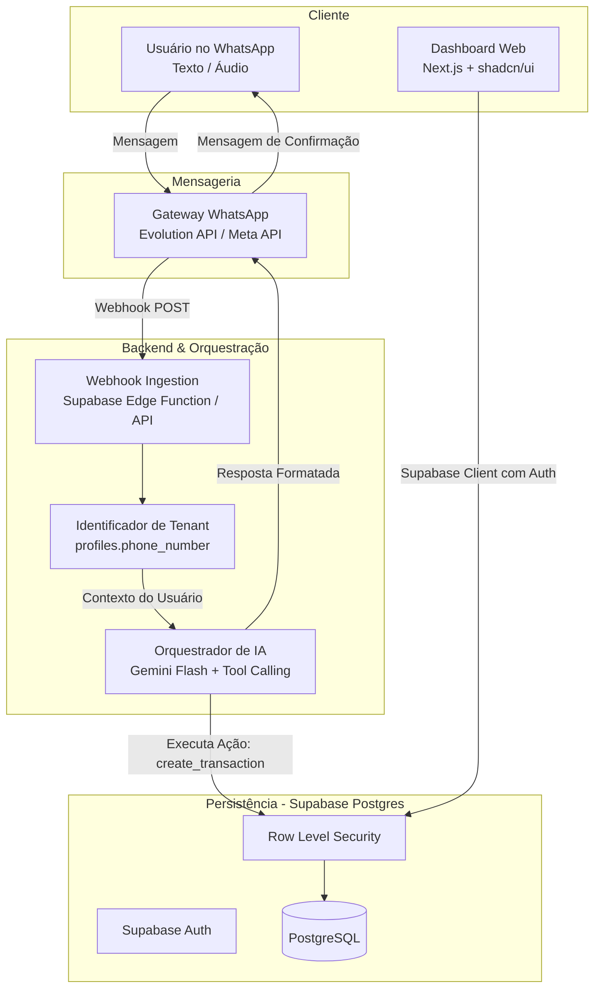
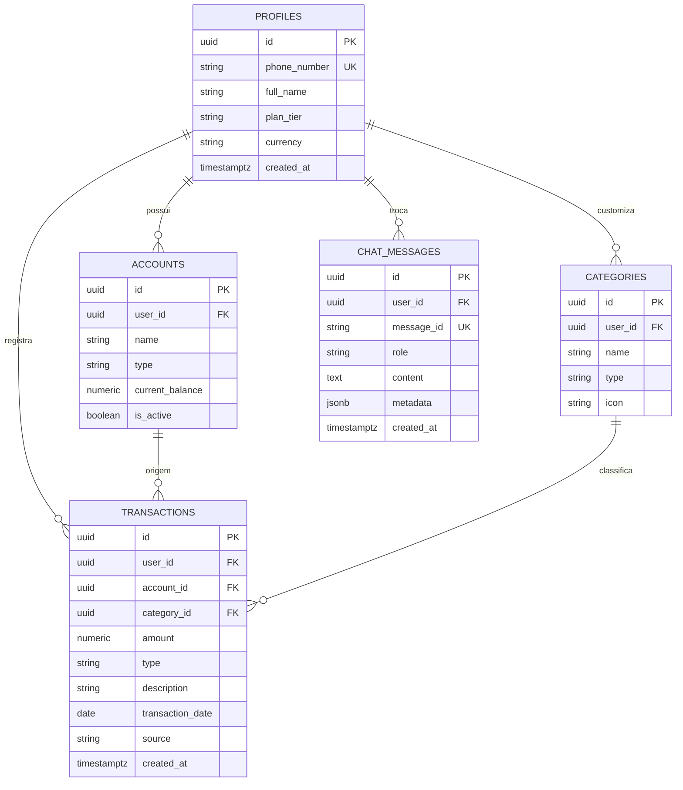

# System Design Review (SDR): SaaS de Controle Financeiro Pessoal (WhatsApp + IA + Supabase)

**Projeto**: FinBot SaaS (Nome Provisório)  
**Versão**: 1.0.0  
**Data**: 2026-10-09  
**Status**: Proposta Inicial para Revisão e Construção  

---

## 1. Visão Geral e Proposta de Valor

### 1.1 O Problema
A taxa de abandono de aplicativos tradicionais de finanças pessoais (PFM) supera 80% nos primeiros 15 dias. A principal causa é a **fricção de registro**: o usuário precisa desbloquear o celular, abrir o app, navegar por telas e preencher formulários para registrar pequenos gastos diários.

### 1.2 A Solução
Um SaaS *headless-first* onde o usuário interage diretamente pelo **WhatsApp** (texto e áudio) com uma IA inteligente que:
1. Interpreta linguagem natural (ex.: *"Gastei 42 reais na padaria no débito"* ou áudios curtos).
2. Categoriza e vincula o gasto à conta/cartão correto de forma autônoma.
3. Alimenta um banco de dados centralizado em tempo real.
4. Fornece relatórios imediatos no chat e um dashboard web completo para visualização analítica profunda.

---

## 2. Papéis do Time de Desenvolvimento

Neste projeto, atuaremos como uma equipe de engenharia ágil:

* 🏛️ **Arquiteto de Software & Engenheiro de Banco (DBA)**: Responsável pela modelagem relacional estrita, índices, constraints e regras de Row Level Security (RLS) no Supabase.
* 🤖 **Engenheiro de Backend & IA**: Responsável pelo pipeline de mensageria, integração de WhatsApp, prompts e chamadas de ferramentas (*tool calling*) no Gemini Flash.
* 🎨 **Engenheiro Frontend / Fullstack**: Responsável pelo dashboard web em Next.js/React e autenticação.
* 🔍 **Desenvolvedor Sênior / Tech Lead**:
  * **Papel**: Fazer o *Code Review* e *Logic Review* rigorosos em cada etapa.
  * **Foco**: Integridade financeira (zero erros de arredondamento), segurança (vazamento de dados multi-tenant), resiliência (idempotência de webhooks do WhatsApp) e custo/eficiência de tokens de IA.

---

## 3. Arquitetura do Sistema

---

## 4. Pipeline de Processamento de Mensagens

1. **Ingestão & Idempotência**: O webhook recebe o evento do WhatsApp. O sistema valida se `message_id` já foi processado nos últimos 5 minutos (evita duplicar gastos caso o WhatsApp reenvie o webhook).
2. **Resolução de Usuário**: O número de telefone (`remoteJid`) é buscado na tabela `profiles`. Se não existir, direciona para o fluxo de onboarding/trial.
3. **Pré-processamento de Áudio**: Se a mensagem for áudio, o arquivo é enviado diretamente ao Gemini Flash (que aceita áudio nativamente, dispensando custos adicionais de Whisper).
4. **Extração com Tool Calling**: A IA recebe o histórico recente da conversa e o catálogo de categorias/contas do usuário. A IA chama a ferramenta adequada:
   * `add_transaction(amount, type, category, account, description, date)`
   * `get_balance(period, category)`
   * `cancel_last_transaction()`
5. **Confirmação Amigável**: Resposta concisa no WhatsApp com formatação rica (negrito, emojis informativos e resumo de impacto no saldo).

---

## 5. Modelagem do Banco de Dados (PostgreSQL / Supabase)

### 5.1 Diretrizes do Desenvolvedor Sênior
> [!IMPORTANT]
> 1. **Zero Float**: Todos os valores monetários devem ser `numeric(15, 2)` ou inteiros em centavos (`bigint`). Proibido `float`/`double precision`.
> 2. **RLS Obrigatório**: Nenhuma tabela de negócio pode existir sem `ALTER TABLE ... ENABLE ROW LEVEL SECURITY`.
> 3. **Timezones**: Datas sempre salvas em `timestamptz` (UTC) com armazenamento do fuso do usuário no perfil.
> 4. **Cartão de Crédito**: Não é conta corrente. Deve possuir dia de fechamento e dia de vencimento.

### 5.2 Estrutura das Tabelas Principais

---

## 6. Riscos, Segurança e Edge Cases

| Risco | Impacto | Mitigação / Solução |
| :--- | :--- | :--- |
| **Mensagem ambígua** (*"Gastei 50"*) | Erro de categorização | A IA assume categoria padrão configurada ou pergunta brevemente no chat: *"Anotado R$ 50! Foi em Alimentação, Transporte ou Outro?"* |
| **Webhook duplicado** | Lançamento duplicado no banco | Tabela de idempotência com `message_id` como chave primária/única. Se já existir, descarta silenciosamente. |
| **Vazamento de dados entre inquilinos** | Violação crítica de privacidade | Isolamento com Supabase RLS (`auth.uid() = user_id`) e execução via `service_role` restrita e auditada dentro das Edge Functions. |
| **Custo de Tokens / Contexto Infinito** | Custo operacional elevado | Manter no contexto da IA apenas as últimas 5 a 10 mensagens e um resumo das categorias ativas. |

---

## 7. Roadmap de Construção (Etapas Incrementais)

* [ ] **Fase 1: Fundação do Banco de Dados & RLS**
  * Script SQL completo: Tabelas, tipos monetários, índices por telefone e políticas RLS.
  * Criação automática de contas e categorias padrão via Trigger quando o usuário se registra.
* [ ] **Fase 2: Motor de IA & Tool Calling**
  * Especificação dos esquemas JSON (`Function Definitions`) do Gemini Flash.
  * Prompt de sistema com tratamento de gírias brasileiras, termos financeiros e áudio.
* [ ] **Fase 3: Webhook do WhatsApp & Orquestração Backend**
  * Implementação da Edge Function / API de recebimento de webhook.
  * Validador de idempotência e mapeamento de telefone -> usuário.
  * Loop de confirmação e formatação de mensagem de resposta no WhatsApp.
* [ ] **Fase 4: Dashboard Web & Autenticação**
  * Interface moderna em Next.js para visualizar gráficos de despesas, saldos e extrato consolidado.
* [ ] **Fase 5: Assinaturas SaaS (Monetização)**
  * Integração com Stripe / Asaas para limites de planos (ex: Free = 30 mensagens/mês; Pro = ilimitado com áudio e múltiplos cartões).

---

## 8. Critérios de Aprovação do Desenvolvedor Sênior

Toda entrega de código deverá passar pelo seguinte checklist antes de ser considerada concluída:
1. **Consistência de Estado**: O saldo da conta reflete matematicamente o somatório das transações?
2. **Tratamento de Erros**: O que acontece se a API do WhatsApp ou da IA cair no meio do fluxo? O usuário recebe uma mensagem amigável ou o sistema trava silenciosamente?
3. **Escalabilidade**: Há índices adequados para buscas por `user_id` e `phone_number`?
4. **Clean Code**: Funções curtas, tipagem estrita (TypeScript), nomes de variáveis descritivos e responsabilidade única.
